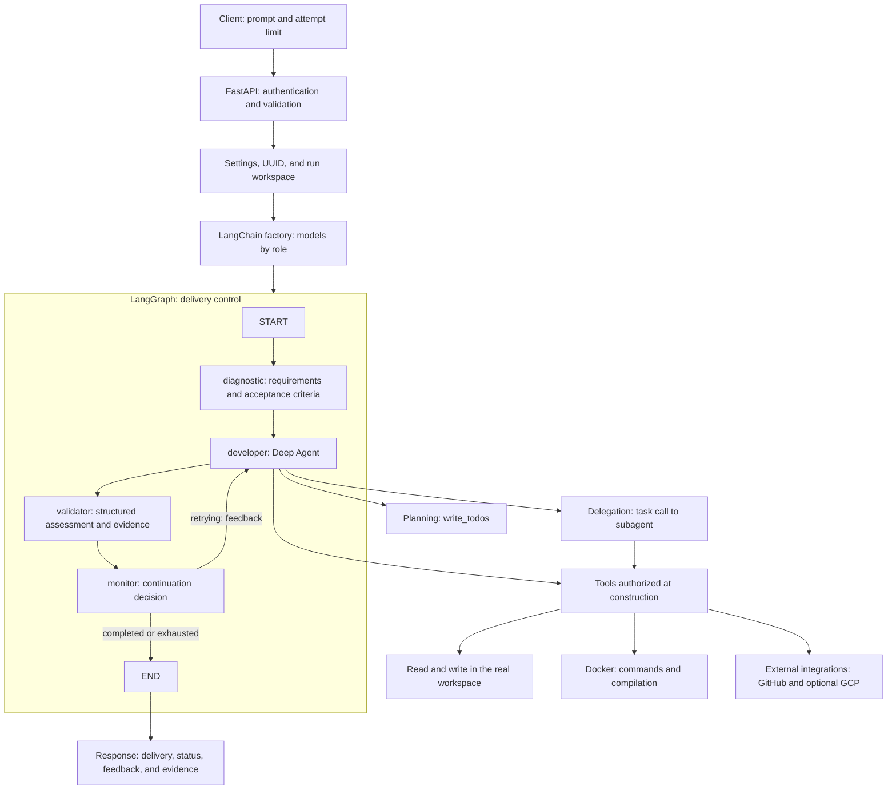
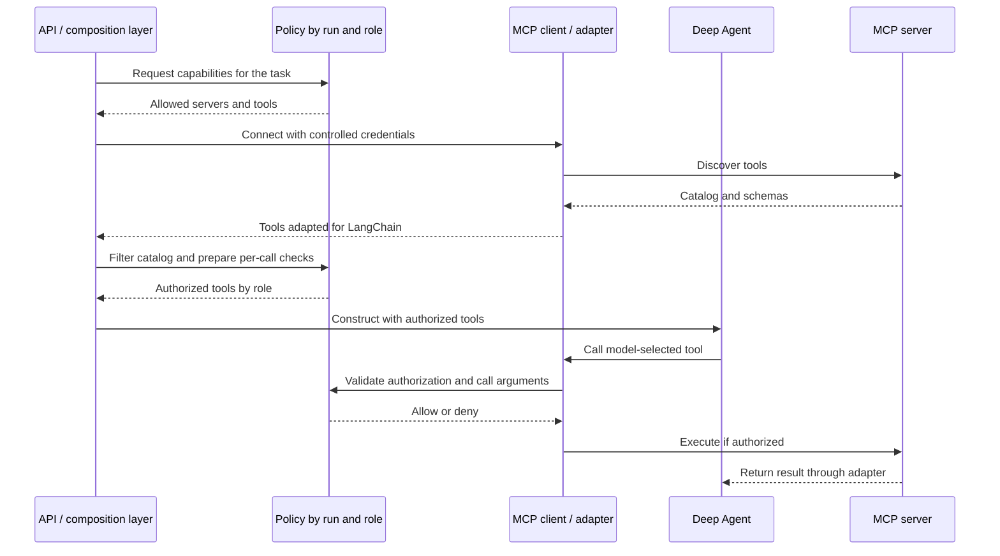

# Agent architecture

This document describes the implemented behavior and extension points. The agent receives a prompt, diagnoses the task, performs actions using tools, evaluates the delivery, and repeats development when needed. Control combines an outer delivery graph with an inner planning and execution agent.

## 1. Overview



Edges between the developer and its tools represent calls within the inner loop. The validator receives control only after the developer invocation returns. A tool call is not a new delivery attempt.

## 2. Which library operates where?

| Component | Library | Specific responsibility |
|---|---|---|
| `api/main.py` | FastAPI | Receive `POST /runs`, check the Bearer token, and return the synchronous result. |
| API contracts, `Verdict`, and configuration | Pydantic / pydantic-settings | Validate inputs, structured output, and environment parameters. |
| `models/factory.py` | LangChain | Construct models with `init_chat_model`, selecting a provider and settings by role. |
| `models/config.yaml` | PyYAML | Load the default model and overrides for `diagnostic`, `developer`, `reviewer`, and `validator`. |
| `orchestration/graph.py` | LangGraph | Execute nodes, store state, apply transitions, and control retries. |
| `agents/developer.py` | Deep Agents | Assemble the harness with planning, virtual files, context management, and delegation. |
| Tools in `agents/developer.py` and `tools/` | LangChain `@tool` | Expose typed functions for model-selected calls. |
| `orchestration/tdd.py` | Application policy | Check the ordered red/green/refactor execution evidence. |
| `agents/validator.py` | LangChain | Request a `Verdict` through `with_structured_output`. |
| Outer graph checkpoints | LangGraph `InMemorySaver` | Record in-memory state during the request. |
| `sandbox/runner.py` | Standard library / Docker | Execute container commands and record actual results. |
| `tools/github.py`, `tools/gcp.py` | HTTPX / optional google-auth | Query external APIs with timeouts and appropriate credentials. |
| `tools/telemetry.py`, `agents/monitor.py` | Logging and monotonic clock | Record duration and status progression. |

LangChain provides the model and tool layer. LangGraph controls the outer flow. Deep Agents also uses LangChain and LangGraph internally: it provides the reasoning, tool-calling, and delegation loop inside the `developer` node.

The current `monitor` is a deterministic function; it does not use an LLM. `diagnostic` and `validator` are specialized model calls, rather than Deep Agents with tools.

## 3. Task lifecycle

1. The client sends `prompt` and `max_iterations` to `POST /runs`. The server requires a token and validates input limits.
2. The API generates a `run_id` and creates `workspaces/<run_id>/`. The workspace starts empty; repositories are not cloned automatically.
3. The factory creates diagnosis, development, review, and validation models. Each role can use a different provider or model.
4. `build_developer` registers tools and available subagents. `build_graph` connects the nodes and installs the checkpointer.
5. `diagnostic` interprets the task and produces requirements, a plan, and verifiable acceptance criteria. These criteria are model-generated text. The plan includes tests, expected red failures, minimal implementation, and refactor verification.
6. `developer` receives the task, diagnosis, and previous feedback. It can plan, call tools, delegate review, write files, and run tests.
7. When the developer returns a final message, the graph increments `iteration` and calls `validator`.
8. The validator assesses the criteria, delivery report, and commands recorded during the attempt. The code also requires successful execution in the current attempt and a recorded red/green/refactor cycle.
9. The monitor decides whether to stop or return to the developer. A retry preserves real files and adds feedback to the new request.
10. The API responds with `run_id`, `status`, `iteration`, `delivery`, `feedback`, `evidence`, and `tdd_evidence`.

## 4. State and memory

`orchestration/state.py` defines `AgentState`:

| Field | Meaning |
|---|---|
| `prompt` | Original user request. |
| `diagnosis` | Requirements, plan, and criteria generated during diagnosis. |
| `delivery` | Developer's final message for the current attempt. |
| `feedback` | Assessment used to guide corrections. |
| `evidence` | Serialized commands and actual results from the current attempt. |
| `tdd_evidence` | Labelled TDD executions retained across attempts in the same run. |
| `iteration` | Number of completed development attempts. |
| `max_iterations` | Effective attempt limit. |
| `approved` | Approval after model assessment and the evidence requirement. |
| `status` | `retrying`, `completed`, or `exhausted`. |

There are three distinct types of memory:

- **Outer state:** LangGraph checkpoints during execution. The API creates a graph per request; it does not recover runs after restart or provide a resume endpoint.
- **Inner context:** Deep Agents messages, planning, and virtual files. Current invocations do not maintain a persistent internal conversation between attempts; the graph resends the task, diagnosis, and feedback.
- **Real workspace:** Files preserved on disk between attempts within the same run. `workspace_read`, `workspace_write`, and Docker commands operate on these files.

Deep Agents' native filesystem tools use the default virtual backend. A file created in that backend does not automatically become a file in the Docker workspace. The prompt therefore instructs the agent to use the dedicated workspace tools for the actual delivery.

## 5. When and how does an agent use a subagent?

### Registering a subagent type

Application code defines allowed types in `agents/developer.py`, through the `subagents` argument to `create_deep_agent`. The model can invoke available types; it is not given a tool to arbitrarily register new Python functions, credentials, or subagent types.

The project explicitly registers a reviewer configuration with these fields (prompt text abbreviated):

```python
{
    "name": "reviewer",
    "description": "Inspect code and run independent TDD and regression checks",
    "system_prompt": "Review real files using the tools. Run tests and report evidence.",
    "model": specialist_model or model,
    "tools": [workspace_read, sandbox_run],
}
```

| Parameter | Role |
|---|---|
| `name` | Identifier selected during delegation, here `reviewer`. |
| `description` | Specialty description that helps the main model decide when to delegate. |
| `system_prompt` | Persistent instructions for the subagent's behavior. |
| `model` | Specialist model; this project uses the `reviewer` role, with a fallback to the main model in the helper. |
| `tools` | Tools explicitly available to the specialist. The reviewer receives real file reading and command execution. |

In the `SubAgent` contract of Deep Agents 0.7.32, installed and recorded in the lock file, `name` and `description` are required. The remaining fields above are optional for the library but are populated by this project. The library also provides fields such as `middleware` and `interrupt_on`, which this implementation does not configure.

In this version, the harness also adds a default `general-purpose` subagent because the project does not disable that behavior. It receives tools from the main agent. The `reviewer` is therefore the explicitly configured specialist, but not necessarily the only available delegation target.

### Runtime decisions and parameters

The main prompt instructs the agent to delegate when useful. The model decides whether a task warrants specialist review or a separate context. There is currently no complexity, file-count, or cost threshold that requires delegation.

The Deep Agents `task` tool receives two model-supplied parameters:

```json
{
  "subagent_type": "reviewer",
  "description": "Read calculator.py and test_calculator.py, run pytest, and return failures, commands used, and evidence. Do not modify the files."
}
```

- `subagent_type` must match an available type.
- `description` contains the complete task, necessary context, criteria, and expected report format. It is more than a title.

The runtime injects its own execution context; the model does not supply that parameter. In the default mode used here, the subagent receives the delegated description as its conversational context, rather than the main agent's entire conversation. It can inspect real files through its granted tools. Its report returns to the main agent as the tool-call result.

The specialist does not replace the `validator` node: delegated review is optional, while outer validation runs after every completed attempt. There is also no application-level policy limiting subagent count or financial cost. Runtime step limits are not equivalent to those policies.

**Permission limitation:** removing `workspace_write` from the reviewer's tool list does not make it read-only. It can still modify files through `sandbox_run`. An instruction not to modify files is guidance, rather than a technical write restriction.

## 6. How are stopping criteria identified?

### Delivery acceptance

Diagnosis turns the prompt into textual criteria. The validator receives those criteria, the delivery, and evidence, and returns:

```python
class Verdict(BaseModel):
    approved: bool
    feedback: str
    evidence: list[str]
```

The effective decision in `orchestration/graph.py` is:

```python
tdd_ok, tdd_feedback = assess_tdd(runner.tdd_history)
execution_ok = bool(runner.history) and runner.history[-1].exit_code == 0
approved = verdict.approved and execution_ok and tdd_ok
```

The final response uses the runner's actual history as `evidence`, rather than the evidence list written by the model in `Verdict`. The current-attempt history is cleared before each attempt. A separate `tdd_history` preserves labelled test runs across attempts and is returned as `tdd_evidence`, so a genuine red result can be followed by green in a retry.

This rule requires successful execution in the current attempt and an ordered TDD cycle: red with exit 1, green with the same command and exit 0, and refactor verification with exit 0. See [TDD workflow and enforcement](tdd.md). It does not prove that tests preceded production edits or that the tests cover every requirement. The current validator does not directly inspect every file. For stronger domain-specific acceptance, extend the `validator` node with deterministic acceptance tests and artifact inspection.

### Monitor decision

| Condition | Status | Next step |
|---|---|---|
| `approved == True` | `completed` | Stop at `END`. |
| Rejected and `iteration >= max_iterations` | `exhausted` | Stop at `END`, exposing feedback. |
| Rejected with attempts remaining | `retrying` | Return to the `developer` node. |

The effective limit is `min(request.max_iterations, settings.max_iterations)`. Both accept values from 1 to 10; the default is 3. The server configures its limit with `AGENT_MAX_ITERATIONS`. Diagnosis runs once; only development, validation, and monitoring repeat.

### Other limits and errors

- The outer graph is invoked with `recursion_limit=100`; the main Deep Agent also receives 100 for its invocation. These are step limits for the respective graphs, not counts of attempts, tokens, or seconds.
- When the inner agent returns its final response, its invocation ends; this does not yet mean the outer graph has approved the task.
- Each Docker command has a default timeout of 120 seconds. A timeout produces code 124; failure to start the client produces 127. These results enter the history and may guide a correction.
- Propagated model, tool, or runtime errors are handled by the API with HTTP 502 and the run identifier. This is an operational failure, rather than `exhausted`.
- Token or cost budgets, an overall task timeout, and explicit client cancellation are not implemented.

## 7. Where is MCP access decided?

### Current implementation

**The project does not yet have an MCP client, server discovery, or an MCP authorization policy.** Current integrations are local functions registered as tools: GitHub over HTTP and PlatformIO through Docker. GCP has an optional factory that is not registered in the default API.

The equivalent point for granting capabilities already exists in `api/main.py`:

```python
developer = build_developer(
    model("developer"),
    runner,
    model("reviewer"),
    [github_issue, build_platformio_tool(runner)],
)
```

The `integrations` list is added to the main agent's tools in `build_developer`. The reviewer receives a separate list. The default `general-purpose` subagent may inherit the main tools, so it must also be considered when granting access.

### Authorization versus tool selection

There are two separate decisions:

1. **The application authorizes and exposes capabilities.** Before constructing the agent, it determines which servers, tools, and credentials are allowed for the run and each role.
2. **The model chooses to use an already available capability.** During the inner loop, it considers the prompt and tool descriptions and emits a call. This must not create a new permission.

The current Bearer token authenticates access to the entire API. It does not implement permissions by user, MCP server, or tool. `orchestration/policies.py` contains configuration and workspace confinement, but does not yet perform these integration checks.

### Proposed MCP extension point

The following diagram is a proposed extension, rather than an implemented flow:



An implementation could use `langchain-mcp-adapters` to convert MCP tools into LangChain tools. That dependency is not currently installed or integrated. The composition layer must also manage connection lifecycles, especially with stdio servers or asynchronous transports.

Initial selection can happen in the API composition layer, with rules in `orchestration/policies.py`. A future `tools/mcp.py` module can encapsulate connection, adaptation, and per-call checks. Credentials remain under application control. Each role should receive an explicit list that accounts for tools inherited by subagents.

There is currently no human approval node, `interrupt`, or resume flow. If a tool requires per-call human authorization, that policy, an interruption with a durable checkpoint, and a resume flow must be implemented. Merely writing the requirement in the prompt does not implement authorization.

## 8. Execution boundaries and future extensions

The API, models, and HTTP integrations run in the host Python process. Only `SandboxRunner` commands run through Docker. The container receives the run workspace, not API credentials, and runs without networking, with limited resources and a read-only root filesystem. `workspace_read` and `workspace_write` operate on the host with path confinement checks.

Evaluation components in `evaluations/` measure and test the system separately; they are not graph nodes. The dataset calls the real API when executed, while automated tests use test doubles and also check construction of the installed Deep Agent.

Natural extensions include per-tool/MCP policies, deterministic domain-specific validation, durable persistence, execution budgets, and a job queue. Implement these as runtime and application controls, alongside model instructions.

Related documents: [TDD](tdd.md), [configuration](configuration.md), [integrations](integrations.md), [security and limitations](security.md), [evaluations](evaluations.md), and [libraries](dependencies.md).
