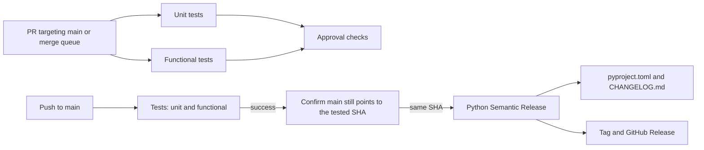

# CI, versioning, and main branch protection

## Workflow



`.github/workflows/tests.yml` runs on pushes to `main`, PRs targeting `main`, merge queues (`merge_group`), and manual dispatch. It has two independent jobs, **Unit tests** and **Functional tests**, using Python 3.11 with a 15-minute timeout each. Each job uploads its JUnit report as an artifact, including when tests fail. Neither job runs the integration directory or requires Docker, provider tokens, or external service access during testing. Installation requires PyPI access.

`.github/workflows/release.yml` uses `workflow_run` to wait for the entire **Tests** workflow. It publishes only when the run succeeded, was triggered by a push to `main`, and belongs to this repository. PRs, merge queues, and manually dispatched runs do not publish versions. The job checks the approved SHA before publishing: if `main` has advanced, it leaves the release to the run for the latest commit. It does not consume PR artifacts or execute PR code with write permissions.

Releases are serialized using concurrency. A concurrent push after the SHA check may cause the release push to be rejected; force-push is not used. In that case, inspect the latest run and rerun **Tests** for the appropriate push event after checking the branch state. Do not use manual dispatch to attempt publication: that event does not authorize a release.

## Conventional Commits and SemVer

Format:

```text
<type>(<optional scope>)!: description

Optional body.

BREAKING CHANGE: describe the incompatibility, when applicable.
```

| Message | Effect after an existing release |
|---|---|
| `fix(api): correct token handling` | Patch: 1.2.3 → 1.2.4 |
| `perf: reduce latency` | Patch: 1.2.3 → 1.2.4 |
| `feat(mcp): add integration` | Minor: 1.2.3 → 1.3.0 |
| `feat(api)!: change contract` | Major: 1.2.3 → 2.0.0 |
| Commit with a `BREAKING CHANGE:` footer | Major |
| `docs`, `test`, `ci`, `chore`, `build`, `style`, or `refactor` without a breaking change | No release on their own |

When there are multiple commits, the highest bump since the last tag takes precedence. The configured parser is `conventional`. Nonconforming messages do not trigger a bump; the workflow is not a linter that rejects invalid messages. Also follow the convention in PR titles when using squash merge, because the title typically becomes the commit message recorded on `main`.

Configuration lives under `[tool.semantic_release]` in `pyproject.toml`. `version_toml` updates `project.version`; tags follow `v{version}`, and generated commits follow `chore(release): {version}`. With no previous tags, `allow_zero_version=false` starts at **1.0.0** when a release-triggering change exists. The initially declared project version, `0.1.0`, is not a published tag or release. There is no PyPI publication.

Python Semantic Release is pinned to `10.7.0` in both development dependencies and the action. Unit tests check interpretation of `fix`, `perf`, `feat`, breaking changes, and commits without a release. The release integration test uses a temporary repository and local execution without pushing.

## Making tests mandatory

The YAML produces checks; enforcement depends on the repository's GitHub rules. After publishing the files and running the workflow for the first time:

1. Open **Settings → Rules → Rulesets** (or branch protection) and create or update a rule for `main`.
2. Require a pull request before merging and enable **Require status checks to pass**.
3. Select **Unit tests** and **Functional tests**, produced by the **Tests** workflow. Select GitHub Actions as the source when available.
4. Require an up-to-date branch or use a merge queue; the `merge_group` event is already configured.
5. Do not add integration tests as a required check. Restrict bypass to identities that actually need it.

Remote settings are not automatically applied by the project files. Until the rule is enabled, a direct push may enter `main` and fail tests afterward. In that case, release is blocked, but the commit already exists on the branch.

## Release bot permissions

By default, tests use `contents: read`; only the release job receives `contents: write`. Release uses `GITHUB_TOKEN`. Commits and tags created with this token do not trigger new push workflows, avoiding an automatic versioning loop.

A protected `main` with required PRs or checks may prevent the default token from pushing the version commit. To keep publication automatic in that setup, configure an automation identity authorized by the rules, such as a GitHub App, with minimal contents write access, and provide its token through the **RELEASE_TOKEN** secret. The workflow uses that secret when present. Token lifecycle and renewal are the responsibility of the automation configuration; do not store tokens in project files. Do not grant all contributors bypass rights to resolve this case.

With a custom token, the release commit may trigger tests again. It does not create a new version because `chore(release)` does not bump SemVer and the commit is already tagged. In either mode, generated commits do not contain `[skip ci]`, to avoid pending checks on protected branches.

## Badge

The README links to the real `.github/workflows/tests.yml` badge, filtered by `branch=main&event=push`, in `pedrolopesc/Agent-Generic`. It displays **passing** only after a successful GitHub run. For forks, update the owner and repository in the link. The badge represents unit and functional tests; release has a separate workflow.

## Local verification

```powershell
python -m pip install -e ".[dev]"
python -m pytest evaluations/tests/unit -m unit
python -m pytest evaluations/tests/functional -m functional
python -m pytest evaluations/tests/integration -m integration
python -m ruff check .
```

Docker execution requires `RUN_DOCKER_TESTS=1`, a running daemon, and a prepared image. Evaluation with a real LLM remains separate in `python -m evaluations.run` and consumes tokens.

Official references: [Python Semantic Release on GitHub Actions](https://python-semantic-release.readthedocs.io/en/latest/configuration/automatic-releases/github-actions.html), [SemVer configuration](https://python-semantic-release.readthedocs.io/en/latest/configuration/configuration.html), [required checks](https://docs.github.com/en/pull-requests/reference/status-checks), and [workflow badges](https://docs.github.com/en/actions/how-tos/monitor-workflows/add-a-status-badge).
