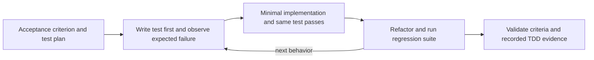

# Test-Driven Development (TDD)

Every development delivery follows **Red → Green → Refactor**. This is both a model instruction and an execution-evidence requirement enforced by the outer graph. There is no additional dependency or configuration switch.

## Development cycle

1. **Plan:** turn each behavior or acceptance criterion into a focused test. Identify the command and expected failure before changing production code.
2. **Red:** write the test first, or select an existing regression test that reproduces a bug. Use `tdd_run_tests` with `phase="red"` and confirm it fails for the intended missing behavior. Fix broken fixtures, syntax, dependencies, or infrastructure before claiming a valid red result.
3. **Green:** implement the smallest change that satisfies the test. Rerun exactly the same test command with `phase="green"` and require a successful result. Do not weaken assertions to make the test pass.
4. **Refactor:** improve structure without changing behavior. Run the relevant regression suite with `phase="refactor"`. This final verification is required even when no cleanup is needed. The command may cover a broader suite than the focused red/green command.
5. Repeat for additional behavior changes and report commands, outcomes, and remaining limitations.



## Tool calls

The developer and the default general-purpose subagent can use the registered tool:

```json
{"command": "pytest -q tests/test_calculator.py", "phase": "red"}
```

```json
{"command": "pytest -q tests/test_calculator.py", "phase": "green"}
```

```json
{"command": "pytest -q", "phase": "refactor"}
```

These are successive `tdd_run_tests` calls with file edits between them, not a script to execute unchanged against the final implementation. The tool executes each command through the existing Docker runner and attaches a validated phase label to its actual command, exit code, and output. It does not accept a model-supplied result or exit code. Test dependencies must already be available in the sandbox image, which has no network access.

`sandbox_run` remains available for inspection and other commands, but its unlabelled results do not establish a TDD cycle. The reviewer can independently run regression checks through `sandbox_run`; it does not receive `tdd_run_tests` directly. The main developer must complete the recorded cycle.

## Runtime acceptance policy

`orchestration/tdd.py` evaluates the ordered test history. Approval requires all of the following:

- The validator model approves the acceptance criteria and the relevance of the tests.
- At least one command in the current attempt ran, and the last command exited with zero.
- The recorded TDD history ends in a completed cycle: red exits with **1**, green reruns the same command successfully with **0**, and refactor/regression verification succeeds with **0**, in that order.

The red/green comparison strips leading and trailing whitespace but otherwise requires identical command strings. Refactor may use a different command for broader coverage. This implementation assumes the test runner uses exit code 1 for test failures. Exit codes such as 2, 124 (timeout), or 127 (client startup failure) do not establish red. A new red phase or a later unsuccessful test phase invalidates a previous completed cycle until a valid cycle is completed again.

A setup failure can also return code 1. The deterministic check cannot classify every test runner's output; diagnosis, developer, reviewer, and validator instructions explicitly require checking the failure cause. The validator sees actual outputs and must reject fake failures, trivial commands, irrelevant coverage, or weakened tests.

If evidence is missing, approval remains false even if the model says to approve. Feedback explains the missing cycle and follows the existing retry policy. The run eventually returns `exhausted` if it cannot meet the requirements within the attempt limit. There is no automatic exemption for documentation-only or other non-code requests; do not fabricate failures to satisfy the gate. Such requests may exhaust the limit under the current development-focused policy.

## Evidence and retries

`SandboxRunner.history` and the response's `evidence` contain the current attempt's commands. Their `phase` is `command` for normal execution or one of `red`, `green`, and `refactor` for TDD runs.

`SandboxRunner.tdd_history`, graph state `tdd_evidence`, and response field `tdd_evidence` retain labelled TDD executions across attempts in the same run. This lets an attempt resume after a genuine red result without deliberately breaking code to recreate the failure. A successful execution is still required in the current attempt. A new API request creates a new workspace and new history; evidence is not durable across process restarts.

The diagnostic model plans the tests, the Deep Agent performs the cycle, `assess_tdd` checks the sequence, the validator assesses meaning and acceptance, and the monitor retains the existing completed/retrying/exhausted decision.

## What the evidence proves

The gate verifies labelled command ordering and outcomes. Phase labels and commands are selected by the model. It does not prove test quality, full coverage, that production files were untouched before red, or that no edits happened after final verification. At least one complete cycle is necessary, but the deterministic check does not map every requirement to its own cycle. Model review must assess that relationship.

For stronger guarantees, extend the runtime with file-change auditing, test discovery and report parsing, deterministic acceptance tests, and isolated read-only review. Current evidence complements review; it is not a proof of correctness or a complete filesystem audit.

## Developing this repository

Use the same practice for changes to the agent itself: add a focused failing test, observe the failure, implement the smallest fix, then refactor and run the affected regression suites. Unit and functional tests remain the required CI categories; integration tests are separate.

```powershell
python -m pytest evaluations/tests/unit -m unit
python -m pytest evaluations/tests/functional -m functional
python -m pytest evaluations/tests/integration/test_developer.py -m integration
python -m ruff check .
```

See [architecture](architecture.md), [test categories and evaluations](evaluations.md), [CI and versioning](ci.md), and [sandbox limitations](security.md).
